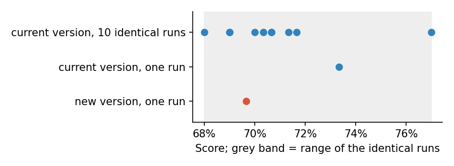

# Measuring a language model honestly

> Public sources only; full references in [SOURCES.md](../SOURCES.md). Every
> number quoted below comes from simulated outcomes in
> [05-illustrations](../05-illustrations/); no language model was called.

## Why this lens

Every other test in this repository produces a number from an evaluation:
failure rates, accuracy, calibration. Language-model evaluations have three
features that make those numbers easy to misread:

- the grader is often another language model;
- the same model gives different answers on different runs;
- results are sliced many ways.

Model-risk guidance asks for effective challenge of models. SR 26-2 leaves
generative AI to firms' own governance, but the principle carries over, and
here it has to include challenging the measurement itself.

## What I read, and what each source changed

| Source | The idea I took from it | What it changed in the tests |
|---|---|---|
| Zheng et al. (2023), *Judging LLM-as-a-Judge with MT-Bench and Chatbot Arena* | Strong LLM judges can agree with humans about as well as humans agree with each other, but show position, verbosity and self-preference biases. | Validate the judge against humans and test its biases (M1) |
| Wang et al. (2024), *Large Language Models are not Fair Evaluators* | Simply swapping the order of two answers can reverse the judge's verdict. | An order-swap test (M1) |
| Miller (2024), *Adding Error Bars to Evals* | Treat an evaluation as an experiment: clustered standard errors, several samples per question, paired differences between models, and power analysis. | Noise floor first, then paired comparisons (M2) |
| Benjamini & Hochberg (1995) | Control the false discovery rate across many comparisons. | Correction across slices (M3) |

## The tests

---

### M1. Validating the judge

**Principle.** An LLM judge is a model, with its own error rate and biases
(Zheng et al., 2023; Wang et al., 2024).

**Objective.** Before any judged result is used, measure the judge's
agreement with human reviewers, how many real failures it misses, and
whether answer order or length sways it.

**Client harm.** A judge that misses failures makes the agent look safer than
it is. A judge that prefers longer answers rewards padding over accuracy.

**Why existing tests miss it.** The judge is treated as a measuring
instrument, not as a model under validation.

**Data.**
- **A sample of the agent's replies labelled independently by human
  reviewers,** using the same written policy the judge is given. The sample
  should include enough real failures to measure the catch rate: with a 10%
  failure rate, 400 replies give about 40.
- **Pairs of answers to the same question,** for comparison-style judging,
  so each pair can be shown in both orders.
- **Answers of similar quality and varying length,** to test whether length
  alone sways the score.
- **The judge's exact prompt and settings,** since changing either makes it a
  different instrument.

**Method.**
1. **Agreement with humans:** Cohen's kappa between judge and reviewers,
   with a bootstrap interval. Kappa corrects for the agreement expected by
   chance, which is high when most replies pass.
2. **Catch rate:** of the replies humans marked as failures, the share the
   judge also marked, with a Wilson interval. This matters more than overall
   agreement, because a judge can agree well overall while missing many of
   the rare failures.
3. **Position bias:** show each pair in both orders and check that the
   verdict holds when the order is swapped.
4. **Length bias:** regress the judge's score on answer length, holding the
   human-rated quality fixed. A positive length effect means padding is
   rewarded.
5. **Evidence check:** require the judge to quote the passage behind each
   verdict, and check by code that the quote really appears in the reply. A
   judge that cites text that is not there is guessing.

**Setting the pass criteria.** Agree, before the judge is used: a minimum
kappa and catch rate, a maximum share of verdicts that reverse when the order
is swapped, and a maximum length effect.
- **Where the catch rate is below 100%,** reported failure rates are
  corrected for it, or a human sample is reviewed alongside every judged
  result.
- **Where position bias is material,** every comparison is run in both
  orders and only consistent verdicts are counted.
- **Any change to the judge's prompt or model** means repeating the test.

**What the illustration shows.** The script simulates 400 replies judged by
a human reviewer and by an LLM judge, 300 pairs shown in both orders, and 500
answers of equal quality but different length.

| Check | Result |
|---|---|
| Agreement with the human (kappa) | 0.79 (95% interval 0.69 to 0.88) |
| Real failures the judge caught | 41 of 46 = 89% (77–95%) |
| Verdict unchanged when the order is swapped | 56% of pairs |
| Answer A chosen when shown first / second | 66% / 41% |
| Effect of 100 extra words, quality held fixed | +0.33 points on a 10-point scale |

On agreement alone, the judge looks good. But it misses about one real
failure in nine, so every failure rate it reports understates the truth by
that much. Its verdict on a pair holds in barely more than half the pairs
when the order is swapped, which means it is partly choosing by position.
And longer answers score higher for no other reason. Used without these
checks, the judge would make the agent look safer than it is, and reward
wordier replies.
[`m1_validating_the_judge.py`](../05-illustrations/m1_validating_the_judge.py)

**Adjacent tests.**
- **G1** depends on the judge to count red-team failures; its catch rate
  feeds directly into G1's numbers.
- **M2** applies to the judge too: it can give different verdicts on
  different runs.
- **K1** checks calibration, which also needs reliable grading of right and
  wrong answers.

**Regulatory hook.** Model-risk principles by extension (effective challenge); FINRA Regulatory Notice
24-09. **NIST AI RMF.** MEASURE 2.13.

---

### M2. Know the noise first

**Principle.** An unchanged model does not score the same twice. Several
samples per question and paired comparisons reduce the noise (Miller, 2024).

**Objective.** Measure the run-to-run variation of the current version
before comparing any new version against it.

**Client harm.** A prompt change is shipped because one lucky run looked
better, or a good change is rolled back because of one unlucky run.

**Why existing tests miss it.** Versions are compared on one run each, as if
the scores were fixed.

**Data.**
- **The evaluation set,** the same for every version compared.
- **The current version and the candidate,** with their settings recorded,
  including temperature and any random seed.
- **Several runs of each** on the whole set, kept question by question, not
  just as a total score.

**Method.**
1. **Measure the noise.** Run the current version several times, unchanged
   (ten here). Take the 95th percentile of the differences between these
   runs as the noise floor: the size of change that noise alone produces
   about one time in twenty.
2. **Compare versions on several runs each,** paired by question: for each
   question, the candidate's average score minus the current version's.
   Pairing removes the question-to-question variation both versions share.
3. **Put a bootstrap interval on the paired difference,** resampling
   questions, since repeated answers to one question are not independent
   evidence.
4. **Size the comparison in advance.** If the change that matters is small
   compared with the noise, more questions or more runs are needed to detect
   it.

**Setting the pass criteria.** A change is reported as real only if its
interval excludes zero, and treated as material only beyond an agreed size.
A single-run difference smaller than the noise floor is never reported as a
change.

**What the illustration shows.** The script simulates 300 questions and a
candidate version that is, in truth, no better or worse than the current one:
its accuracy differs only by small random amounts question by question.

| Comparison | Result |
|---|---|
| Current version, run 10 times unchanged | Scores from 68.0% to 77.0% |
| Noise floor | 7.8 points |
| One run each | Candidate 3.7 points *worse* |
| Five runs each, paired by question | +2.1 points (95% interval −0.7 to +5.0) |

The same version scores anywhere from 68% to 77%, so a 3.7-point drop on a
single run is well inside ordinary variation, yet it might have led to the
candidate being rejected. The paired comparison over five runs shows a
difference that cannot be told from zero, which is the truth in this
simulation. A team reading single runs would have reached a firm conclusion
in the wrong direction.

*The ten blue dots are the same version scored ten times; the grey band is
their range. Both single runs used in the comparison fall inside it, so the
3.7-point gap between them says nothing.*

[`m2_noise_floor.py`](../05-illustrations/m2_noise_floor.py)

**Adjacent tests.**
- **V1** measures how deterministic the agent is in production settings.
- **V2** compares versions for behaviour changes, using this noise floor.
- **B1** uses the same idea: the opinion effect is judged against the
  change from running the same chat twice.

**Regulatory hook.** Model-risk principles by extension (change control). **NIST AI RMF.** MEASURE 2.13.

---

### M3. Multiple testing across the suite

**Principle.** Slicing results by category, level and persona multiplies the
number of tests, and with it the chance alarms.

**Objective.** Report regressions across slices with the false discovery
rate controlled.

**Client harm.** Real regressions are lost among false alarms, or releases
are blocked by noise until the alarms are ignored.

**Why existing tests miss it.** Each slice is read on its own, and nobody
counts how many slices were looked at.

**Data.** Every slice comparison the evaluation produces: for each slice
(for example, each combination of topic, client risk level and persona), the
results of the old and new versions.

**Method.**
1. **Collect the p-value of every slice comparison** in one table, including
   the slices that look fine.
2. **Apply the Benjamini–Hochberg procedure** at the agreed rate. With many
   slices, some will look worse by chance; the procedure limits the share of
   alarms that are false.
3. **Report regressions from the corrected table only.** Keep uncorrected
   results as exploratory leads, to be confirmed on new runs before anyone
   acts on them.

**Setting the pass criteria.** Agree the false discovery rate before
looking (10% here, a common choice for release screening). Pass if every
regression reported is backed by the corrected table.

**What the illustration shows.** The script simulates 144 slices, each with
400 replies per version. Three slices genuinely get worse in the new
version, by 10 percentage points; the rest are unchanged.

| Reading | Alarms | Real | False |
|---|---|---|---|
| Each slice at p < 0.05 | 6 | 3 | 3 |
| False discovery rate controlled at 10% | 3 | 3 | 0 |

Read slice by slice, half the alarms are false, and each one would cost an
investigation or hold up a release. With the false discovery rate
controlled, the three real regressions remain and the false ones go.
[`m3_multiple_testing.py`](../05-illustrations/m3_multiple_testing.py)

**Adjacent tests.**
- **V2** compares versions slice by slice and relies on this correction.
- **K2** compares calibration across many groups.
- **M2** sets how large a change each slice comparison can detect.

**Regulatory hook.** Model-risk principles by extension (effective challenge). **NIST AI RMF.** MEASURE 2.13.

## How the tests fit together

M1 checks the instrument, M2 the noise, M3 the number of looks. Every other
lens relies on all three.
